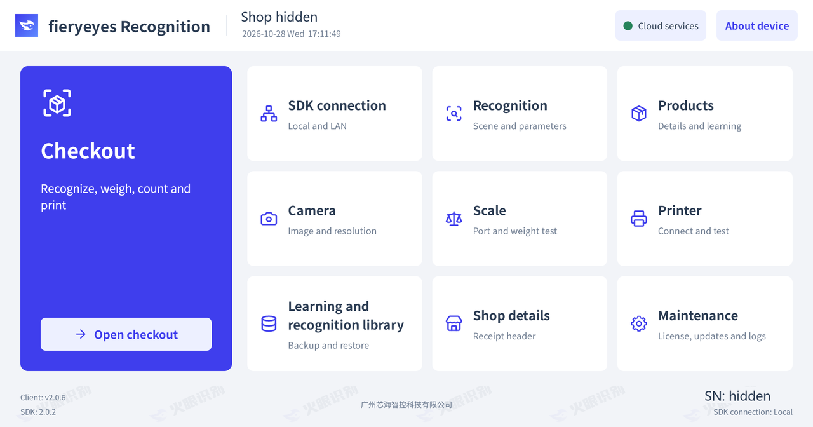
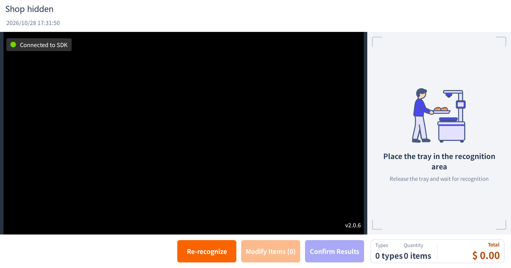

# HuoYan Retail Android App

An Android product recognition and checkout app for fresh food, snacks, bakery products and small dishes.

[中文](README.md) · [Website and activation](https://www.huoyan.cc) · [Downloads](https://github.com/huoyan-ai-opensource/huoyan-opensource-retail-android/releases)

The project's own App and client JAR source code is available for everyone to use. Recognition requires a separately installed HuoYan SDK and activation arranged with HuoYan. See the [usage and activation rules](USAGE.md) and [third-party notices](THIRD_PARTY_NOTICES.md); the repository does not designate an MIT or Apache 2.0 license for all its contents.

## Get started

| Goal | Documentation |
| --- | --- |
| Run the complete App | [Quick start](QUICKSTART.md) in Chinese: install the App and SDK, activate a model, wait for readiness, create and learn a product, then recognize it |
| Integrate the client JAR into your App | [English integration guide](huoyan-sdk-client/INTEGRATION_GUIDE.en.md), [SDK overview](huoyan-sdk-client/README.en.md), and [Java example](huoyan-sdk-client/samples/RecognitionIntegrationExample.java) |
| Read the Word integration guide offline | [English](app/src/main/libs/huoyan-sdk-client-2.0.0-integration-guide.en.docx) · [Chinese](app/src/main/libs/huoyan-sdk-client-2.0.0-integration-guide.zh-CN.docx) |
| Build or contribute | [Build setup](docs/build.md), [testing](docs/testing.md), and [contributing](CONTRIBUTING.md) in Chinese |

The App package is `cc.huoyan.retail`; the client JAR package is `cc.huoyan.sdk.client`; the separately installed recognition SDK package is `cc.huoyan`.

## Interface

| Home | Checkout waiting for recognition |
| --- | --- |
|  |  |

App 2.0.6 on a C50 device with English selected in the App. Shop and device identifiers have been hidden.

[Chinese and English screenshots](docs/images/README.md). Landscape and portrait designs are maintained in the [shared design source](design/huoyan-retail.pen).

## Build

Use JDK/JBR 17, Android SDK 33, NDK 25.2.9519653 and CMake 3.22.1. Gradle 7.5 does not support Java 21.

```bash
bash gradlew :app:assembleDebug
bash gradlew :app:testDebugUnitTest :huoyan-sdk-client:testDebugUnitTest
```

On Windows PowerShell use `.\gradlew.bat` instead of `bash gradlew`. The App uses a committed JAR; after changing SDK source, run `:huoyan-sdk-client:updateAppSdkJar` before rebuilding the App. Build a full SDK ZIP with `:huoyan-sdk-client:clientDistribution`.

Default Release APKs use a publicly shared experimental signing key, restricted to non-commercial experiments and testing. Use your own signing key for production distribution; see [signing instructions](signing/README.md).

## Releases and support

Download the App APK, client JAR ZIP, Chinese and English Word integration guides, and SHA-256 checksums from [GitHub Releases](https://github.com/huoyan-ai-opensource/huoyan-opensource-retail-android/releases), or build from source. Both Word guides retain their project filenames inside the ZIP and as separate Release Assets; see the [release requirements](docs/releasing.md) (Chinese). App, client JAR and SDK versions are independently managed; see the [compatibility notes](docs/version-compatibility.md) and [changelog](CHANGELOG.md).

GitHub build checks and releases are started manually by maintainers. Branch pushes, pull requests and version tags do not automatically start a build or publish a release. See the [release guide](docs/releasing.md).

For activation, package registration or private support, contact HuoYan through the [official website](https://www.huoyan.cc). Report ordinary bugs through [GitHub Issues](https://github.com/huoyan-ai-opensource/huoyan-opensource-retail-android/issues). Do not post activation codes, account credentials or security vulnerabilities publicly; see [security reporting](SECURITY.md).
