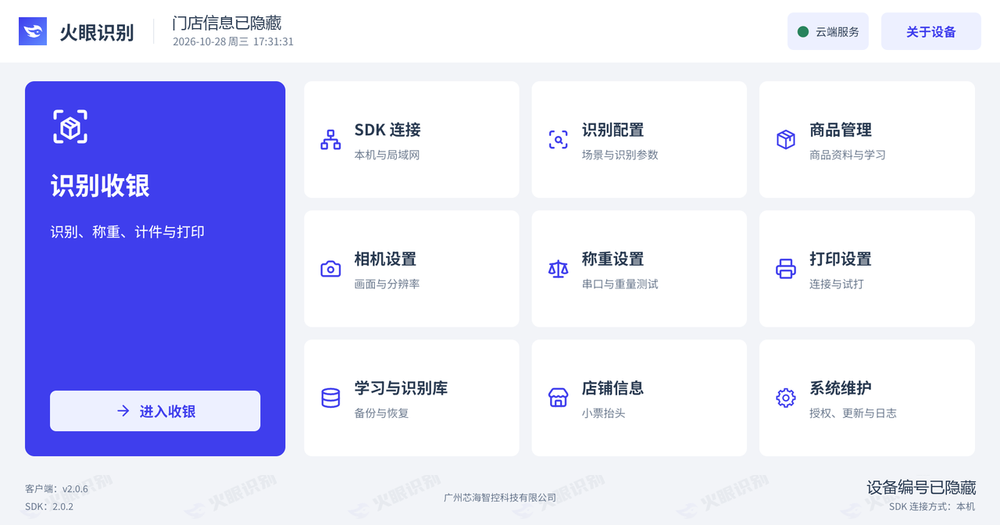
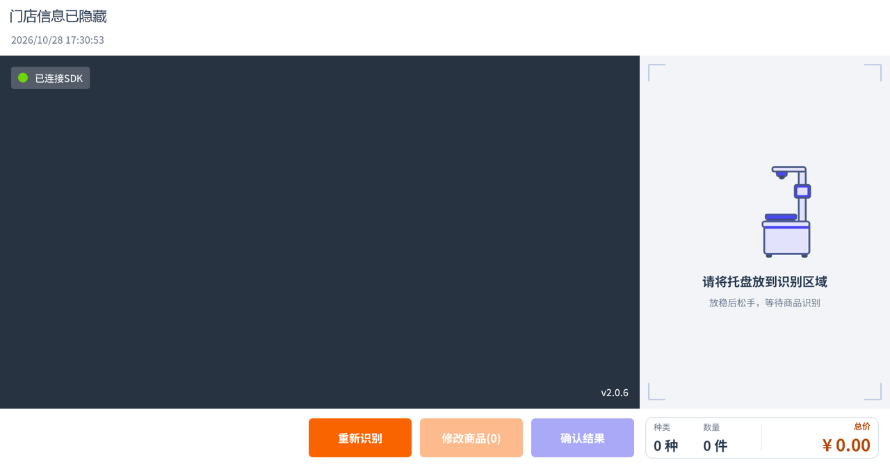

# 火眼识物开源 App

面向 **生鲜、零食、烘焙、小碗菜** 场景的 Android 商品识别与收银客户端。可直接运行完整 App，也可把客户端 JAR 接入自己的 Android 应用。

[English](README.en.md) · [官网与激活联系](https://www.huoyan.cc) · [下载](https://github.com/huoyan-ai-opensource/huoyan-opensource-retail-android/releases) · [第一次运行](QUICKSTART.md) · [文档导航](docs/README.md)

**源码所有人都可以使用；识别功能需要联系火眼激活配套 SDK。** App 源码、SDK 运行授权和第三方组件的范围分别见[使用与激活说明](USAGE.md)、[第三方组件说明](THIRD_PARTY_NOTICES.md)。

## 选择你的使用方式

| 你要做什么 | 从这里开始 |
| --- | --- |
| 安装并体验完整 App | [快速开始](QUICKSTART.md)：安装 App 与 SDK → 激活选模 → 等模型就绪 → 新增商品 → 拍照学习 → 识别结算 |
| 在自己的 App 中接入识别 | [JAR 中文接入指南](huoyan-sdk-client/INTEGRATION_GUIDE.md) · [English Integration Guide](huoyan-sdk-client/INTEGRATION_GUIDE.en.md) · [Java 示例](huoyan-sdk-client/samples/RecognitionIntegrationExample.java) |
| 修改本项目 | [构建环境](docs/build.md) → [代码结构](docs/code-structure.md) → [测试](docs/testing.md) → [贡献指南](CONTRIBUTING.md) |

完整 App 使用 `cc.huoyan.retail` 包名，JAR 使用 `cc.huoyan.sdk.client`。识物 SDK 是另行安装的应用，包名为 `cc.huoyan`；JAR 负责通信，不包含识别引擎或模型。

## 功能与界面

- 商品资料管理、商品拍照学习、学习样本预览与删除、识别库备份恢复。
- 相机识别、手动改品、计件与称重计价、混合购物车计算及结算确认。
- USB UVC 与 Camera2 相机接入，称重和打印模块可按场景开关。
- SDK 本机或局域网连接、激活选模、授权与模型状态展示。
- 可选的门店和云端服务接入；离线能力按 SDK 证书、密钥、模型和真实回执判断。

| 功能首页 | 收银等待识别 |
| --- | --- |
|  |  |

以上为 App 2.0.6 的 C50 中文横屏实机界面，门店和设备标识已隐藏。英文界面见 [English README](README.en.md) 和[中英文截图对照](docs/images/README.md)。相机未采集画面时，收银预览区域为空。横竖屏页面统一维护在[设计源文件](design/huoyan-retail.pen)中。

## 下载与激活

App APK、JAR 交付 ZIP 和 SHA-256 摘要通过 [GitHub Releases](https://github.com/huoyan-ai-opensource/huoyan-opensource-retail-android/releases) 或 [CNB Releases](https://cnb.cool/xinhaizhikong/xlabs/huoyan-opensource-retail-android/-/releases) 提供；某平台暂无附件时，可按[构建指南](docs/build.md)从源码构建。

识物 SDK 的当前默认[下载入口](http://f.huoyan.cc/apk/object_sdk_lastest.apk)也已集成在 App 安装引导中。下载前通过[官网](https://www.huoyan.cc)联系火眼，确认设备、芯片、包名登记、激活和模型支持。下载入口沿用既有文件名 `lastest`，不表示任意版本都配套；版本关系见[兼容说明](docs/version-compatibility.md)。

`connect` 成功、`initialize` 返回成功、`activate` 返回成功都不能单独证明模型可用。识别和学习统一以 `SdkStatus.modelReady(status)` 判断；`OFFLINE` 时还需证书有效且密钥未丢失。完整步骤见[快速开始](QUICKSTART.md)。

## 构建与测试

需要 JDK/JBR **17**、Android SDK **33**、NDK **25.2.9519653** 和 CMake **3.22.1**。Gradle 7.5 不支持 Java 21；环境安装、Android Studio 配置和签名说明见[构建指南](docs/build.md)。

Windows PowerShell，在配置好 `JAVA_HOME` 后运行：

```powershell
.\gradlew.bat :app:assembleDebug
.\gradlew.bat :app:testDebugUnitTest :huoyan-sdk-client:testDebugUnitTest
```

macOS / Linux：

```bash
bash gradlew :app:assembleDebug
bash gradlew :app:testDebugUnitTest :huoyan-sdk-client:testDebugUnitTest
```

App 使用已打包的 `app/src/main/libs/huoyan-sdk-client-2.0.0.jar`，构建不会自动更新它。修改 JAR 源码后，先运行 `:huoyan-sdk-client:updateAppSdkJar`，再构建 App；完整交付包由 `:huoyan-sdk-client:clientDistribution` 生成。

Debug 使用本机调试签名；默认 Release 使用公开的[实验签名](signing/README.md)，仅供非商业实验与测试。正式发布使用自己的签名，通过未入库的 `local.properties` 配置；该实验签名限制不等同于 App 自有源码的使用规则。

## 文档与协作

| 内容 | 文档 |
| --- | --- |
| 运行与使用 | [快速开始](QUICKSTART.md) · [硬件](docs/hardware.md) · [常见问题](docs/faq.md) |
| 开发与交付 | [构建](docs/build.md) · [测试](docs/testing.md) · [版本兼容](docs/version-compatibility.md) · [发布](docs/releasing.md) · [更新记录](CHANGELOG.md) |
| JAR 交付 | [架构](huoyan-sdk-client/ARCHITECTURE.md) · [账号配置与出包](huoyan-sdk-client/PACKAGING.md) |
| Word 对接文档 | [识物 JAR 2.0.0 接入指南](app/src/main/libs/huoyan-sdk-client-2.0.0-接入指南.docx)，与 JAR 一同放在 `app/src/main/libs` |
| 支持与贡献 | [联系与支持](SUPPORT.md) · [贡献指南](CONTRIBUTING.md) · [安全问题](SECURITY.md) · [交流约定](CODE_OF_CONDUCT.md) |

普通问题和 PR 可在 [GitHub](https://github.com/huoyan-ai-opensource/huoyan-opensource-retail-android) 提交，CNB 上的原有仓库也保留。报告问题时附所用平台和提交号；已有跨平台讨论时附原链接。激活码、账号和安全漏洞通过[私密反馈渠道](SECURITY.md)处理。

GitHub 分支和 PR 自动检查构建与测试，版本 tag 触发 GitHub 发布。CNB 发布流程在 CNB 仓库维护；两端的提交、tag 和附件分别管理，操作方式见[发布说明](docs/releasing.md)。编码代理约定见 [AGENTS.md](AGENTS.md)。
